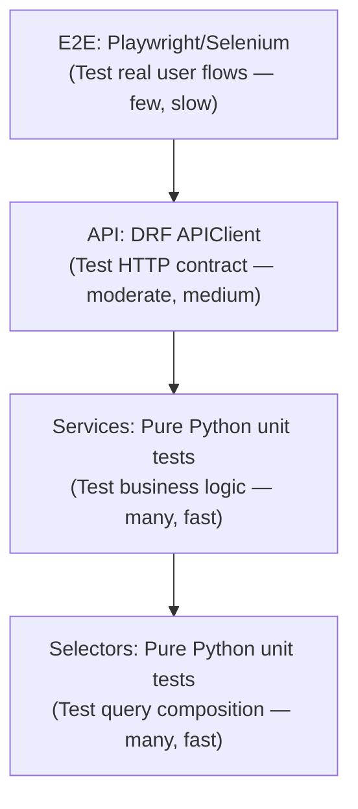

# Django Production Ops

This skill covers the engineering practices that separate a prototype from a production system: testing strategy, security hardening, caching, structured logging, and deployment safety.

---

## 1. Testing Strategy

### The Testing Pyramid for Service-Layer Architecture

The Service Layer pattern makes the testing pyramid extremely practical:



### Unit Testing Services

Services are pure Python. No HTTP setup, no `APIClient`, no `RequestFactory`. Just call the function.

✅ **Recommended:**
```python
# apps/billing/tests/test_services.py
import pytest
from decimal import Decimal
from unittest.mock import patch
from django.test import TestCase
from apps.billing.services import create_payment_for_invoice
from apps.billing.models import Invoice, Payment
from apps.billing.exceptions import InvoiceAlreadyPaid

class TestCreatePaymentForInvoice(TestCase):
    def setUp(self):
        self.invoice = Invoice.objects.create(
            amount=Decimal("100.00"),
            status=Invoice.Status.UNPAID,
        )

    def test_creates_payment_with_correct_amount(self):
        payment = create_payment_for_invoice(
            invoice=self.invoice,
            amount=Decimal("100.00"),
            payment_method_id="pm_test_123",
        )
        self.assertEqual(payment.amount, Decimal("100.00"))
        self.assertEqual(payment.status, Payment.Status.PROCESSING)

    def test_raises_if_invoice_already_paid(self):
        self.invoice.status = Invoice.Status.PAID
        self.invoice.save()

        with self.assertRaises(InvoiceAlreadyPaid):
            create_payment_for_invoice(
                invoice=self.invoice,
                amount=Decimal("100.00"),
                payment_method_id="pm_test_123",
            )

    @patch("apps.billing.services.send_payment_receipt_task")
    def test_enqueues_receipt_task_after_commit(self, mock_task):
        create_payment_for_invoice(
            invoice=self.invoice,
            amount=Decimal("100.00"),
            payment_method_id="pm_test_123",
        )
        # on_commit fires in TestCase when ATOMIC_REQUESTS is False
        mock_task.delay.assert_called_once()
```

### Integration Testing API Endpoints

Use `APIClient` only for testing the HTTP layer: URL resolution, authentication enforcement, serializer validation, and HTTP status codes.

```python
# apps/billing/tests/test_apis.py
from rest_framework.test import APITestCase
from rest_framework import status
from unittest.mock import patch

class TestInvoicePaymentApi(APITestCase):
    def setUp(self):
        self.user = User.objects.create_user(email="test@example.com", password="pass")
        self.client.force_authenticate(self.user)
        self.invoice = Invoice.objects.create(user=self.user, amount=Decimal("100.00"))

    @patch("apps.billing.apis.create_payment_for_invoice")
    def test_post_calls_service_with_correct_args(self, mock_service):
        mock_service.return_value = Payment(id=1, amount=Decimal("100.00"), status="processing")
        
        response = self.client.post(f"/api/billing/invoices/{self.invoice.id}/pay/", {
            "amount": "100.00",
            "payment_method_id": "pm_test_123",
        })
        
        self.assertEqual(response.status_code, status.HTTP_201_CREATED)
        mock_service.assert_called_once_with(
            invoice=self.invoice,
            amount=Decimal("100.00"),
            payment_method_id="pm_test_123",
        )

    def test_returns_401_for_unauthenticated_user(self):
        self.client.logout()
        response = self.client.post(f"/api/billing/invoices/{self.invoice.id}/pay/", {})
        self.assertEqual(response.status_code, status.HTTP_401_UNAUTHORIZED)

    def test_returns_400_for_negative_amount(self):
        response = self.client.post(f"/api/billing/invoices/{self.invoice.id}/pay/", {
            "amount": "-50.00",
            "payment_method_id": "pm_test_123",
        })
        self.assertEqual(response.status_code, status.HTTP_400_BAD_REQUEST)
        self.assertIn("amount", response.data)
```

### pytest + pytest-django

Prefer `pytest-django` over `unittest.TestCase` for new projects. Fixtures are composable and test setup is cleaner.

```python
# conftest.py
import pytest

@pytest.fixture
def user(db):
    return User.objects.create_user(email="test@example.com", password="pass")

@pytest.fixture
def auth_client(user):
    from rest_framework.test import APIClient
    client = APIClient()
    client.force_authenticate(user)
    return client
```

---

## 2. Security Hardening

### Settings Checklist for Production

```python
# config/settings/production.py

DEBUG = False
ALLOWED_HOSTS = env.list("ALLOWED_HOSTS")

# HTTPS enforcement
SECURE_HSTS_SECONDS = 31536000      # 1 year
SECURE_HSTS_INCLUDE_SUBDOMAINS = True
SECURE_HSTS_PRELOAD = True
SECURE_SSL_REDIRECT = True          # Redirect all HTTP to HTTPS
SECURE_PROXY_SSL_HEADER = ("HTTP_X_FORWARDED_PROTO", "https")  # When behind Nginx/LB

# Cookie security
SESSION_COOKIE_SECURE = True        # Only send session cookie over HTTPS
SESSION_COOKIE_HTTPONLY = True      # JavaScript cannot read the session cookie
SESSION_COOKIE_SAMESITE = "Lax"    # CSRF protection
CSRF_COOKIE_SECURE = True
CSRF_COOKIE_HTTPONLY = True

# Content Security
X_FRAME_OPTIONS = "DENY"           # Prevents clickjacking
SECURE_CONTENT_TYPE_NOSNIFF = True # Prevents MIME-type sniffing
```

Run `python manage.py check --deploy` to validate these automatically.

### Authentication with JWT (djangorestframework-simplejwt)

```python
# config/settings/base.py
REST_FRAMEWORK = {
    "DEFAULT_AUTHENTICATION_CLASSES": [
        "rest_framework_simplejwt.authentication.JWTAuthentication",
    ],
    "DEFAULT_PERMISSION_CLASSES": [
        "rest_framework.permissions.IsAuthenticated",  # Auth required by default
    ],
}

SIMPLE_JWT = {
    "ACCESS_TOKEN_LIFETIME": timedelta(minutes=15),   # Short-lived access tokens
    "REFRESH_TOKEN_LIFETIME": timedelta(days=7),
    "ROTATE_REFRESH_TOKENS": True,   # Issue new refresh token on each use
    "BLACKLIST_AFTER_ROTATION": True, # Invalidate old refresh token
    "ALGORITHM": "HS256",
    "SIGNING_KEY": env("JWT_SECRET_KEY"),
}
```

### Object-Level Permissions with `django-guardian`

Row-level permissions (e.g., only the document owner can edit it) are not covered by Django's built-in permission system. Use `django-guardian` for database-backed object permissions.

```python
from guardian.shortcuts import assign_perm, get_objects_for_user

# Assign permission when creating
assign_perm("billing.change_invoice", request.user, invoice)

# Filter queryset to only objects user has permission for
invoices = get_objects_for_user(request.user, "billing.view_invoice")
```

---

## 3. Caching

### Caching Levels: Selector-Level vs View-Level

Cache at the **lowest effective level** to maximize reuse across different views and endpoints.

| Level | When to use | Risk |
|---|---|---|
| View-level (`@cache_page`) | Fully public, never user-specific | Returns stale data to all users |
| Selector-level | Per-user data, expensive queries | Requires careful key construction and invalidation |
| Fragment-level | Specific template fragments | Template caching; not useful in API-only projects |

✅ **Recommended (Selector-level caching):**
```python
# apps/billing/selectors.py
from django.core.cache import cache

SUBSCRIPTION_CACHE_TIMEOUT = 60 * 5  # 5 minutes

def get_active_subscriptions_for_user(*, user_id: int) -> list[Subscription]:
    cache_key = f"subscriptions:active:user:{user_id}"
    
    result = cache.get(cache_key)
    if result is not None:
        return result
    
    result = list(
        Subscription.objects
        .filter(user_id=user_id, status=Subscription.Status.ACTIVE)
        .select_related("plan")
    )
    cache.set(cache_key, result, timeout=SUBSCRIPTION_CACHE_TIMEOUT)
    return result
```

✅ **Invalidation via `post_save` signal (acceptable here — infrastructure concern):**
```python
from django.db.models.signals import post_save, post_delete
from django.dispatch import receiver
from django.core.cache import cache

@receiver([post_save, post_delete], sender=Subscription)
def invalidate_subscription_cache(sender, instance, **kwargs):
    cache_key = f"subscriptions:active:user:{instance.user_id}"
    cache.delete(cache_key)
```

### Redis Configuration

```python
# config/settings/production.py
CACHES = {
    "default": {
        "BACKEND": "django_redis.cache.RedisCache",
        "LOCATION": env("REDIS_URL"),
        "OPTIONS": {
            "CLIENT_CLASS": "django_redis.client.DefaultClient",
            "SOCKET_CONNECT_TIMEOUT": 5,
            "SOCKET_TIMEOUT": 5,
            "IGNORE_EXCEPTIONS": True,  # Falls through to DB if Redis is down
        },
        "KEY_PREFIX": "myapp",          # Prevents key collisions across projects
        "TIMEOUT": 300,
    }
}
```

---

## 4. Structured Logging

Django's default `LOGGING` config logs plain text. Production systems need structured (JSON) logs that can be indexed by Elasticsearch, CloudWatch, or Datadog.

✅ **Recommended (`python-json-logger`):**
```python
# config/settings/production.py
LOGGING = {
    "version": 1,
    "disable_existing_loggers": False,
    "formatters": {
        "json": {
            "()": "pythonjsonlogger.jsonlogger.JsonFormatter",
            "format": "%(asctime)s %(levelname)s %(name)s %(message)s",
        },
    },
    "handlers": {
        "console": {
            "class": "logging.StreamHandler",
            "formatter": "json",
        },
    },
    "root": {
        "handlers": ["console"],
        "level": "INFO",
    },
    "loggers": {
        "django.db.backends": {
            "level": "WARNING",  # Set to DEBUG locally to see SQL queries
            "handlers": ["console"],
            "propagate": False,
        },
    },
}
```

✅ **Logging with structured context:**
```python
import logging

logger = logging.getLogger(__name__)

def generate_report_service(*, report: Report) -> None:
    logger.info(
        "Report generation started",
        extra={"report_id": report.id, "user_id": report.user_id}
    )
    try:
        # ... work ...
        logger.info("Report generation completed", extra={"report_id": report.id})
    except Exception:
        logger.exception(
            "Report generation failed",
            extra={"report_id": report.id}
        )
        raise
```

> `logger.exception()` automatically includes the full traceback. Always use it inside `except` blocks — never `logger.error(str(e))`.

---

## 5. Database Connection Management

### Connection Pooling with `pgBouncer`

Django creates one database connection per web worker. Under load, this can exhaust PostgreSQL's `max_connections` (default: 100). Use `pgBouncer` in transaction mode to multiplex many application connections onto a smaller pool of real DB connections.

```python
# config/settings/production.py — Point to pgBouncer port, not Postgres directly
DATABASES = {
    "default": {
        "ENGINE": "django.db.backends.postgresql",
        "HOST": env("PGBOUNCER_HOST"),
        "PORT": env("PGBOUNCER_PORT", default=6432),
        "NAME": env("DB_NAME"),
        "CONN_MAX_AGE": 0,  # Required in pgBouncer transaction mode — don't persist connections
    }
}
```

### `CONN_MAX_AGE` (without pgBouncer)

Without pgBouncer, setting `CONN_MAX_AGE = 60` (seconds) enables persistent connections in Django's connection pool, reducing the overhead of per-request connection setup.

```python
DATABASES = {
    "default": {
        ...
        "CONN_MAX_AGE": 60,  # Reuse connection for up to 60 seconds
        "CONN_HEALTH_CHECKS": True,  # Django 4.1+ — validate connection before reuse
    }
}
```

## Navigation
- [Core Architecture](../django-core-architecture/SKILL.md)
- [Models & ORM](../django-models-orm/SKILL.md)
- [Views & APIs](../django-views-apis/SKILL.md)
- [Business Logic](../django-business-logic/SKILL.md)
- [Testing Layout](../django-testing-layout/SKILL.md)
