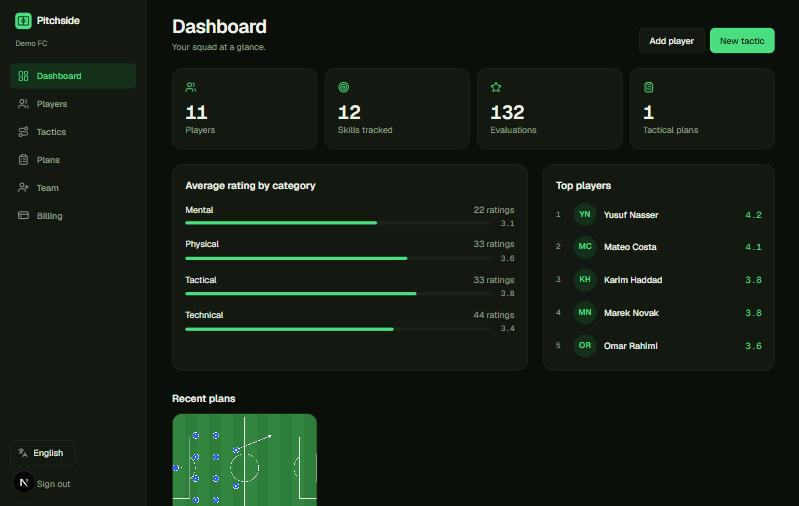
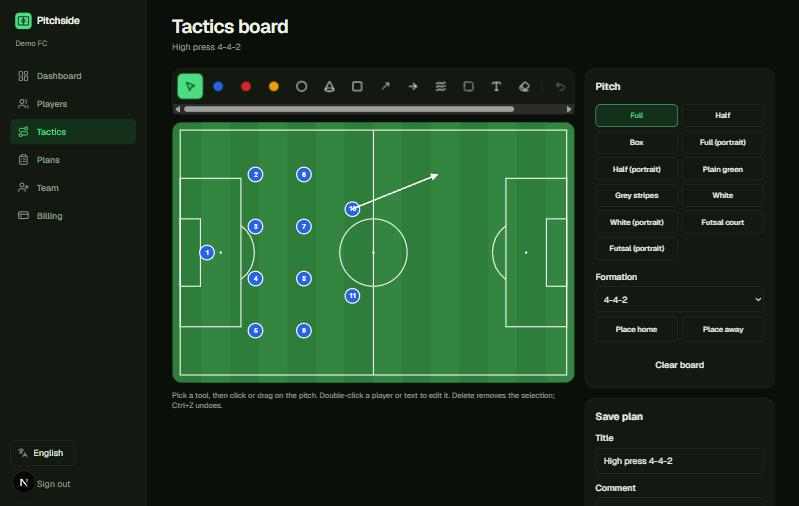

# footballClub — API

[](https://patreon.com/AliIbrahim870)

Django REST API behind **Pitchside**: multi-tenant clubs, players, skill evaluations, tactical plans, a one-time free trial per club, Stripe billing, team invites and public plan sharing. The web UI is in the **footballClub-frontend** repo (Next.js); run both together with Docker Compose from there.

## Engineering highlights
The API behind Pitchside, upgraded from a 2021 Django 3.2 monolith to a headless **Django 6.1 / DRF** service on **PostgreSQL**:

- **Multi-tenant by design**: every record belongs to a club, queries go through one scoping mixin, and cross-club access is covered by tests (a coach from club B cannot read, rate or delete club A's players).
- **Subscription gating that is hard to bypass**: expired trials return HTTP 402; the one-free-trial rule is enforced by a unique, normalized email key in the database (so `+tag` and Gmail-dot aliases and concurrent sign-ups do not get a second trial); self-service sign-up can be closed with one switch and is then refused at the API, not only in the UI.
- **Billing and teams**: Stripe Checkout, customer portal and webhook handlers (verified-event logic is unit tested and idempotent), owner-managed invitations with seat limits and expiry, and public read-only plan share links.
- **Safe by default**: debug off unless asked, secrets and database host required (it refuses to start rather than silently falling back to SQLite), no credentials in code or infrastructure files, throttled login/sign-up/contact endpoints that read the real client IP behind a proxy.
- **Tests never touch real services**: `manage.py test` switches to dedicated settings that clear every production variable (I ran the suite with a fake production database host, Stripe key and S3 setting exported to prove it). 39 automated tests, run in CI against a real PostgreSQL service.
- **Tagged plans**: tags are normalized (case, spacing, duplicates) and stored so any database can filter them exactly (`?tag=set-piece` never matches `set-piece-2`); plans also carry the simulation steps as JSON.
- **Pluggable media storage**: one setting (`MEDIA_STORAGE=local|s3|gcs|azure`) chooses where uploads live, with provider options covered by tests.
- **Internationalized API**: messages follow `Accept-Language` (English and Arabic).
- **Migrations with data**: existing rows were moved into a default club by a data migration, with the constraint made strict in a third step.

### Honest limits
- The Stripe integration is tested with simulated events, not against a live Stripe account.
- No audit log of who viewed data, and no self-service "delete my club" yet (it is a manual admin task).
- The Cloud Run deploy workflow is a template that has not been run.



> Screenshots show the frontend with fictional demo data.

## Run locally
```bash
python -m venv .venv
.venv\Scripts\activate
pip install -r requirements.txt
set DJANGO_DEBUG=1              # local development only: SQLite + throw-away secret key (PowerShell: $env:DJANGO_DEBUG="1")
python manage.py migrate
python manage.py seed --admin   # fictional demo club; prints a generated admin password once (or set SEED_ADMIN_PASSWORD)
python manage.py runserver
python manage.py test           # always runs on isolated settings: in-memory DB, no Stripe/mail/bucket
```
Without `DJANGO_DEBUG=1` the app refuses to start unless `DJANGO_SECRET_KEY` and `POSTGRES_HOST` are configured.
Interactive API docs: http://localhost:8000/api/docs/ · Admin: http://localhost:8000/admin/

## Main endpoints (`Authorization: Token <key>`)
| Method | Path | Purpose |
|---|---|---|
| POST | `/api/contact/` | public "contact us" form (stored + e-mailed); the way in while sign-ups are closed |
| POST | `/api/auth/register/` | create club (14-day trial) + owner, returns token; **403 unless `SIGNUPS_OPEN=1`** |
| POST | `/api/auth/login/` · `/api/auth/accept-invite/` | sign in · join a club by invite |
| GET | `/api/auth/me/` | user + club status (trial / active / past_due / canceled) |
| GET | `/api/dashboard/` | totals, top players, category averages |
| CRUD | `/api/players/` | search `?search=`, order `?ordering=` |
| POST | `/api/players/{id}/evaluate/` | `{"ratings":[{"skill":1,"value":4}]}` |
| CRUD | `/api/skills/`, `/api/categories/`, `/api/plans/` | plans: PNG `image` + `board` JSON |
| GET/POST/DELETE | `/api/team/`, `/api/team/invites/`, `/api/team/members/{id}/` | owner-only team management, seat limit |
| POST/DELETE | `/api/plans/{id}/share/` · GET `/api/shared/{token}/` | public read-only plan link |
| POST | `/api/billing/checkout/` · `/portal/` · `/webhook/` | Stripe (inert until configured) |

All club data is scoped to the caller's club. An expired trial/subscription returns **HTTP 402**. Messages follow `Accept-Language` (en/ar).

## Docker Compose (API + PostgreSQL)
```bash
docker compose up --build
```
Copy `.env.example` to `.env` and fill in `DJANGO_SECRET_KEY` and `POSTGRES_PASSWORD`; compose refuses to start without them (no default credentials are shipped). Demo data is off by default (`SEED_DEMO_DATA=1` enables it; the admin password is `SEED_ADMIN_PASSWORD` or generated and printed once).
Standalone image: `docker build -t footballclub-api .`. For Google Cloud Run (Cloud Storage uploads, `POSTGRES_SSLMODE`), Stripe and email setup see `docs/DEPLOY.md` in the frontend repo.

## Media storage
Uploads go to local disk by default. Set `MEDIA_STORAGE` to switch without code changes:

| `MEDIA_STORAGE` | Needs | Notes |
|---|---|---|
| `local` | `MEDIA_ROOT` | served by Django; use a volume |
| `s3` | `AWS_STORAGE_BUCKET_NAME` (+ optional region / `AWS_S3_ENDPOINT_URL` for R2, MinIO, Spaces) | AWS IAM role or standard AWS variables |
| `gcs` | `GS_BUCKET_NAME` | Google Cloud service account (Cloud Run default identity) |
| `azure` | `AZURE_ACCOUNT_NAME`, `AZURE_CONTAINER` (+ key or connection string) | Azure Blob Storage |

`MEDIA_PUBLIC=0` uses private buckets with signed URLs. Details in `web_application/storage.py`.

## What changed in v2
Server-rendered templates and the embedded iframe were removed; Django is now API-only, packages were upgraded (Django 6.1, DRF 3.18), the app became multi-tenant with billing, and the tactics board is rebuilt natively in the frontend.

## Support the project
If this is useful to you, you can support its development on **[Patreon](https://patreon.com/AliIbrahim870)**.

## License
[MIT](LICENSE) © 2026 Ali Ibrahim
